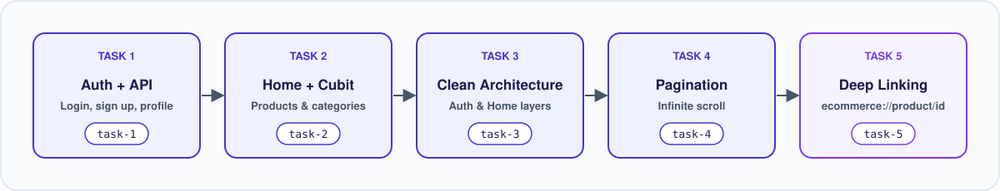
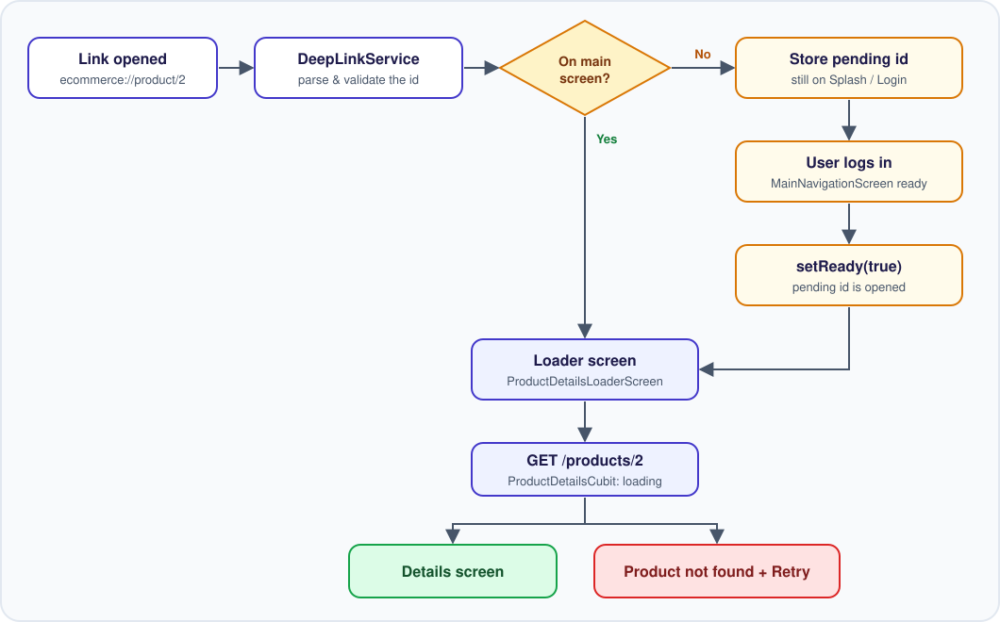
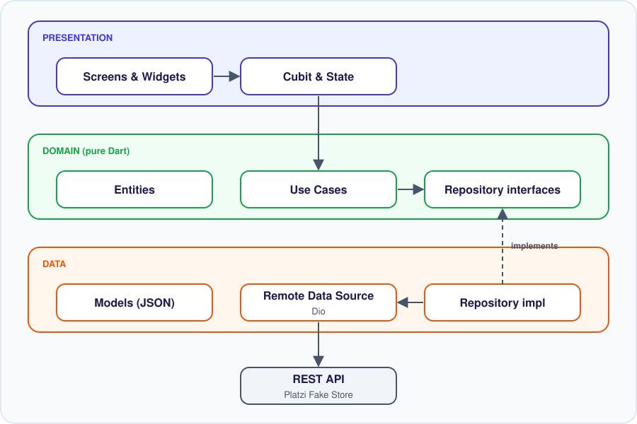

<div align="center">


<br/>


-7c3aed?style=for-the-badge)


**A Flutter e-commerce app built step by step across 5 tasks: REST API integration, state management, Clean Architecture, pagination, and Deep Linking.**

[Overview](#-overview) •
[Project Journey](#-project-journey) •
[Features](#-features) •
[Deep Linking](#-deep-linking) •
[Architecture](#-architecture) •
[Getting Started](#-getting-started)

</div>

---

## 📖 Overview

Huma-volve lets users sign in, browse products by category with infinite scrolling, and open a specific product directly from an external link.

The project was developed as **5 tasks, each on its own Git branch**, so the history shows how the app grew from a simple API integration into a layered, production-style codebase.

## 🧭 Project Journey

| # | Branch | Task | What was built |
|:-:|:------:|------|----------------|
| 1 | `task-1` | **Auth feature using the API** | Login, sign up, and profile fetching from the REST API |
| 2 | `task-2` | **Home feature + state management** | Products and categories from the API, managed with Cubit (loading / success / failure) |
| 3 | `task-3` | **Clean Architecture for Auth & Home** | Refactored both features into Data / Domain / Presentation layers |
| 4 | `task-4` | **Pagination in Home** | Infinite scroll with offset/limit loading and a bottom loader |
| 5 | `task-5` | **Deep Linking in Product Details** | `ecommerce://product/<id>` opens the product, with cold-start and error handling |

<p align="center">
  
</p>

## ✨ Features

| Area | What it does |
|------|--------------|
| 🔐 **Authentication** | Login, sign up, and loading the user profile from the API |
| 🏠 **Home** | Product grid, category filter chips, and **infinite scroll pagination** |
| 📦 **Product Details** | Image with Hero animation, price, description, color and size selection, Add to Cart |
| 🔗 **Deep Linking** | Open any product from `ecommerce://product/<id>` |
| 🛒 **Cart** | Cart screen with item cards |
| 👤 **Profile** | Profile screen and logout |
| ⚡ **Splash** | Splash screen before login |

## 🔗 Deep Linking

```
ecommerce://product/2
└────┬────┘ └──┬──┘ └┬┘
  scheme     host    product id
```

| Scenario | Result |
|----------|--------|
| App is open | Product details open immediately |
| App is closed | App starts, the link is **kept pending until login**, then the product opens automatically |
| Product deleted or invalid id | Clear *"Product not found"* message with a **Retry** button, no crash |
| Unrelated or malformed link | Ignored safely |

<p align="center">
  
</p>

**Implementation highlights**

- `AndroidManifest.xml` registers an `intent-filter` for the `ecommerce://product` scheme and disables Flutter's default deep link handler so [`app_links`](https://pub.dev/packages/app_links) can receive the links.
- `DeepLinkService` is a singleton that listens to the link stream, parses the id, and navigates through a global `navigatorKey` (no `BuildContext` needed).
- A **pending link** is held until `MainNavigationScreen` calls `setReady(true)`, so the splash and login flow is never skipped.
- `GetProductByIdUseCase` reuses the Home domain layer, and the repository maps the API's `400/404` responses to a friendly message.

**Try it on an emulator or device**

```bash
adb shell am start -a android.intent.action.VIEW -d "ecommerce://product/2"

# A product that does not exist
adb shell am start -a android.intent.action.VIEW -d "ecommerce://product/999999"
```

> 💡 The API is a shared public one, so some products may be deleted over time. If an id shows *Product not found*, try another.

## 🏗️ Architecture

The app uses **Clean Architecture** with a feature-first structure. Auth and Home are fully layered (Task 3).

<p align="center">
  
</p>

| Layer | Responsibility |
|-------|----------------|
| **Presentation** | Screens, widgets, Cubits and states |
| **Domain** | Entities, abstract repositories, use cases. No dependency on Flutter or packages |
| **Data** | JSON models, `dio` data sources, repository implementations that convert API errors into user-friendly messages |

<details>
<summary><b>📁 Project structure</b></summary>

```
lib/
├── main.dart
├── core/
│   ├── network/          # API constants, token storage
│   ├── widgets/          # Shared widgets (buttons, text fields)
│   ├── theme.dart
│   └── dummy_data.dart
└── features/
    ├── auth/
    │   ├── data/         # datasources, models, repo
    │   ├── domain/       # entities, repos, usecases
    │   └── presentation/ # cubit, screens
    ├── home/
    │   ├── data/
    │   ├── domain/
    │   └── presentation/
    ├── details/
    │   ├── cubit/        # ProductDetailsCubit and state
    │   ├── deep_link/    # DeepLinkService
    │   ├── screens/      # Details and loader screens
    │   └── widgets/      # Color and size selectors
    ├── cart/
    ├── profile/
    ├── main_navigation/
    └── splash/
```

</details>

## 🧰 Tech Stack

| Purpose | Technology |
|---------|------------|
| Framework | Flutter and Dart |
| State management | [`flutter_bloc`](https://pub.dev/packages/flutter_bloc) (Cubit) |
| Networking | [`dio`](https://pub.dev/packages/dio) |
| Deep links | [`app_links`](https://pub.dev/packages/app_links) |
| Backend | [Platzi Fake Store API](https://fakeapi.platzi.com/) |

<details>
<summary><b>🌐 API endpoints used</b></summary>

Base URL: `https://api.escuelajs.co/api/v1`

| Method | Endpoint | Purpose |
|--------|----------|---------|
| `POST` | `/auth/login` | Sign in |
| `GET` | `/auth/profile` | Current user profile |
| `POST` | `/users/` | Register |
| `GET` | `/products?offset=&limit=` | Paginated products |
| `GET` | `/products/{id}` | Single product (Deep Linking) |
| `GET` | `/categories` | Categories |

</details>

## 🚀 Getting Started

**Prerequisites:** [Flutter SDK](https://docs.flutter.dev/get-started/install), Android Studio or VS Code, and an Android emulator or device.

```bash
# 1. Clone the repository
git clone https://github.com/Youssef-Wheed/Ecommerce-Huma-volve.git
cd Ecommerce-Huma-volve

# 2. Install dependencies
flutter pub get

# 3. Run the app
flutter run
```

**Demo account** (public test user from the API)

| Email | Password |
|-------|----------|
| `john@mail.com` | `changeme` |

> ⚠️ After changing `AndroidManifest.xml`, stop the app and run `flutter run` again. Hot Reload is not enough.

**Explore each task:**

```bash
git checkout task-1   # Auth
git checkout task-3   # Clean Architecture
git checkout task-5   # Deep Linking
```

## ⚠️ Known Limitations

- Deep Linking supports **Android** with a **custom scheme** only. iOS and `https` App Links need a domain and a verification file.
- The access token is kept **in memory**, so the user signs in again after the app is fully closed.
- Color and size options on the details screen are static, because the API does not provide them.
- The search bar is UI only for now.

## 🗺️ Roadmap

- [ ] iOS support for Deep Linking
- [ ] `https` App Links with domain verification
- [ ] Persistent token storage
- [ ] Working search and favorites
- [ ] Real cart and checkout flow

## 👨‍💻 Author

**Youssef Waheed**
Flutter Developer · Computer Science graduate, Minia University

[](https://github.com/Youssef-Wheed)
[](https://www.linkedin.com/in/youssef-waheed-a40a77263/)

---

<div align="center">

Built with 💙 using Flutter

</div>